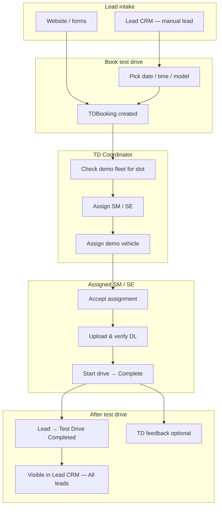

# Patliputra VinFast — Test Drive & Lead CRM End-to-End Flow

**For client / operations review**  
**Portal:** [https://patliputravinfast.in/admin](https://patliputravinfast.in/admin)  
**Document version:** November 2026  
**Audience:** TD Coordinator, Sales Managers, Sales Executives, CRE, Management  

This document describes the **full journey** from creating a lead in CRM, booking a test drive, coordinating fleet and staff, running the drive, and seeing the customer back in **Lead CRM** — including recent improvements (fleet preview by slot, assignment acceptance, dashboard visibility).

---

## 1. Big picture (one page)

| Stage | Who owns it | Primary screen |
|--------|-------------|----------------|
| Lead creation & follow-up | CRE / SM / SE | **Lead CRM** |
| Test drive booking (from lead) | CRE / SM / SE | **Lead CRM** → Book test drive |
| Fleet check & assignment | **TD Coordinator** | **TD Bookings** |
| Run the test drive | Assigned **SM / SE** | **TD Bookings** or **My Test Drives** |
| Pipeline & reporting | SM / Management | **Dashboard**, **Lead CRM**, **TD Reports** |

---

## 2. Roles (who does what)

| Role | Login example | Main modules |
|------|----------------|--------------|
| **TD Coordinator** | `tdcoordinator@patliputravinfast.com` | TD Bookings, Demo Fleet, Slot config (view), Calendar |
| **Sales Manager (SM)** | e.g. `sudhanshu@…` | Lead CRM, TD Bookings, My Test Drives, Dashboard |
| **Sales Executive (SE)** | Field staff login | My Test Drives, Lead CRM (own/team), TD Bookings (assigned) |
| **CRE / CRM desk** | CRE login | Lead CRM (full list), assign leads, book TD |
| **Management** | Admin / GM / MD | All modules, approvals, reports |

**Visibility rule:** Sales Managers and Executives normally see **their team’s** leads and bookings unless they have wider admin access.

---

## 3. Flow A — Customer comes from the website

1. Visitor submits **Test Drive** (or enquiry) on [patliputravinfast.in](https://patliputravinfast.in).
2. System creates/updates **customer** (mobile) and a **CRM lead**.
3. A **TD booking** is created for the chosen **model**, **branch**, **date**, and **time** (capacity follows **slot config** + **demo fleet** per model/trim).
4. Booking is routed to the **TD Coordinator** (assigned executive on the booking until they delegate).
5. Continue from **Section 5** (coordinator steps).

---

## 4. Flow B — You create a lead in Lead CRM, then book a test drive

This is the path you described: **Lead CRM → Book test drive → Coordinator takes over.**

### Step B1 — Create the lead

1. Go to **Admin → Lead CRM**.
2. **Add lead** (or import): name, mobile, model, source, assign to SM/SE if known.
3. Work the lead (follow-ups, stage e.g. Enquiry / Interested).

### Step B2 — Book test drive from the lead

1. Open the lead **detail**.
2. Use **Book test drive** (or equivalent action on the lead).
3. Choose:
   - **Model** (from **Model Master** — must be an active catalog model),
   - **Branch** (e.g. Patna Showroom),
   - **Date & time** (only slots that are **open** per branch slot configuration and fleet capacity).
4. Confirm.

**System result:**

- A **TDBooking** row is created and linked to the lead (`leadId`).
- Lead stage moves toward **Test Drive Booked** (when booking is confirmed, not pending repeat approval).
- Booking is assigned to the **TD Coordinator** for triage (unless repeat-drive approval is pending).

### Step B3 — Lead CRM “All leads” after TD

- When the test drive is **completed**, the lead stage becomes **Test Drive Completed** and **`lastActivityAt`** is updated.
- The lead appears in **Lead CRM** with filter **All leads (incl. TD done)** and **All stages**, sorted by **recent activity** (so completed TDs are not “lost” at the bottom of a long list).
- You can still filter **Test Drive Completed** only using the stage chips.

---

## 5. TD Coordinator workflow (before & during assignment)

**Screen:** **TD Management → TD Bookings** → open booking → **Verify & Manage**.

Recommended order (matches the UI):

### Step C1 — Review customer & slot

Confirm:

- Customer name, mobile, **model** (and variant if captured),
- **Slot** date & time,
- **Branch**.

### Step C2 — Demo fleet for this slot *(check before assigning executive)*

Section: **“Demo fleet for this slot”** (top of the manage dialog).

This uses:

- **Model Master** (correct model / trim),
- **Demo fleet** tagged to the branch,
- **Slot configuration** (capacity per time slot),
- **Existing bookings** at the same date/time (cars already committed show as *not assignable*).

You will see:

| Info | Meaning |
|------|--------|
| Slot capacity | How many cars can run that model at that time |
| Bookings at this time | How many TDs already booked in that slot |
| Assignable now | How many demo cars you can still assign |
| Table per car | **Can assign** vs **In use for this slot** / locked / status |

**If assignable count is 0:** reschedule the customer (**Reschedule** in the same dialog) or adjust fleet in **Demo Fleet** / **Slot config** — do not assign an executive until a car path exists (or client agrees to reschedule).

### Step C3 — Assign sales executive (SM / SE)

**Step 1 — Assign staff**

1. Choose the executive from the dropdown (full staff list for coordinator).
2. **Save executive**.

**System:** `assignmentStatus` = **Pending acceptance** until the assignee accepts (or starts the drive — see Section 6).

### Step C4 — Assign demo vehicle

**Step 1b — Assign demo vehicle**

1. Dropdown lists only **assignable** vehicles for this booking’s slot/model.
2. Select registration (model, trim, battery %).
3. **Save vehicle assignment**.

When both **executive** and **vehicle** are set, booking status typically becomes **CONFIRMED** (if it was PENDING).

### Step C5 — Driving licence (optional before handover)

Coordinator or assignee can use **DL verify** in the same flow so the SM/SE is not blocked at **Start driving**.

---

## 6. Assigned SM / SE workflow (run the test drive)

**Screens:** **TD Bookings → Verify & Manage** (same booking) **or** **My Test Drives**.

### Step D1 — Accept assignment

If the banner **“Confirm this assignment”** appears:

- Tap **Accept**, **or**
- Enter opening odometer and tap **Start driving** (system can **accept automatically** when the assigned person starts).

**Reject** sends the booking back to the **TD Coordinator** for reassignment.

### Step D2 — Verify driving licence

Upload / verify DL if not already done (**required** before start).

### Step D3 — Start driving

1. Enter **opening odometer (km)**.
2. Tap **Start driving** → booking **IN_PROGRESS**.

### Step D4 — Complete test drive

1. Enter **closing odometer**, photos / location / remarks as prompted.
2. **Mark completed** → booking **COMPLETED**.
3. Optional: **customer feedback** (rating / intention).

**System:** CRM lead syncs to **Test Drive Completed**, assignment and activity timestamps update; dashboard KPIs and drill-downs show the correct **executive** name.

---

## 7. Dashboard & reporting (management view)

| KPI / action | What you see |
|--------------|--------------|
| **Test Drive / TD MTD / Pending** on Dashboard | Counts; click for **drill-down list** |
| Drill-down **Executive** column | Assigned SM/SE name (not “Unassigned” when populated) |
| **Lead CRM** stage chips | Counts per stage; **Test Drive Completed** filter matches list |
| **TD Reports / Calendar** | Bookings by date, executive, model |

---

## 8. Configuration dependencies (for IT / admin)

These masters must be correct for fleet preview and booking to work:

| Master | Purpose |
|--------|---------|
| **Model Master** | Models & variants on forms, CRM, and fleet tagging |
| **Demo Fleet** | Physical TD cars per branch, model, trim, status AVAILABLE/BOOKED |
| **TD Slot config** | Working hours, slot times, blocked dates, per-branch rules |
| **User Master (TDStaff)** | Executives, coordinator, `reportsTo` hierarchy |
| **Branches** | Patna Showroom etc. linked to bookings and fleet |

---

## 9. Status cheat sheet

### Booking status (`bookingStatus`)

| Status | Meaning |
|--------|---------|
| PENDING | Created; may need vehicle/executive or approval |
| CONFIRMED | Executive + vehicle (or ready for drive) |
| IN_PROGRESS | Drive started |
| COMPLETED | Drive finished |
| CANCELLED | Cancelled (record kept) |
| RESCHEDULED | Slot changed |

### Assignment status (`assignmentStatus`)

| Status | Meaning |
|--------|---------|
| UNASSIGNED | No executive |
| PENDING_ACCEPTANCE | Executive nominated; must accept |
| ACCEPTED | Executive confirmed |
| REJECTED | Executive declined; back to coordinator |

### CRM lead stage (related)

Enquiry → Interested → **Test Drive Booked** → **Test Drive Completed** → Negotiation → Booking → Delivered (or Lost).

---

## 10. Quick checklist — TD Coordinator (printable)

- [ ] Open new booking from **TD Bookings** (or notification).
- [ ] Read **Demo fleet for this slot** — at least one **Can assign** OR reschedule.
- [ ] Assign **SM/SE** → Save executive.
- [ ] Assign **demo vehicle** → Save vehicle.
- [ ] Confirm DL path (verify or ask assignee).
- [ ] Inform assignee to **Accept** and run TD on slot day.

---

## 11. Quick checklist — Sales Executive / Manager on TD day

- [ ] Open booking in **My Test Drives** or **TD Bookings**.
- [ ] **Accept** assignment (if prompted).
- [ ] **DL verified**.
- [ ] **Opening odometer** → **Start driving**.
- [ ] **Closing odometer** → **Mark completed**.
- [ ] Capture **feedback** if required.
- [ ] Continue negotiation in **Lead CRM**.

---

## 12. Example timeline (CRM lead → completed TD)

| Time | Actor | Action |
|------|--------|--------|
| Day 1 | CRE | Creates lead in **Lead CRM**, assigns SM |
| Day 1 | SM | **Books test drive** from lead — VF 7, Patna, 4 Nov 4:30 PM |
| Day 1 | TD Coordinator | Opens booking; **fleet table** shows 2 assignable VF 7 cars |
| Day 1 | TD Coordinator | Assigns **Sudhanshu (SM)** + **BR01TD7004** |
| Day 2 | Sudhanshu | **Accepts**, verifies DL, **starts** / **completes** drive |
| Day 2 | System | Lead = **Test Drive Completed**; visible under **All leads** |
| Day 3 | SM | Follow-up in CRM → Negotiation / Booking |

---

## 13. Support & URLs

| Item | Value |
|------|--------|
| Public website | https://patliputravinfast.in |
| Admin portal | https://patliputravinfast.in/admin |
| Lead CRM | `/admin/crm/leads` |
| TD Bookings | `/admin/td/bookings` |
| My Test Drives | `/admin/td/my-bookings` |
| Demo Fleet | `/admin/td/vehicles` (module name may vary) |
| Slot configuration | TD Slot config in admin |

For technical API and data model detail, see **`DATA_FLOW_DOCUMENTATION.md`** in the same repository.

---

*Patliputra VinFast — Test Drive & CRM workflow (client copy).*
